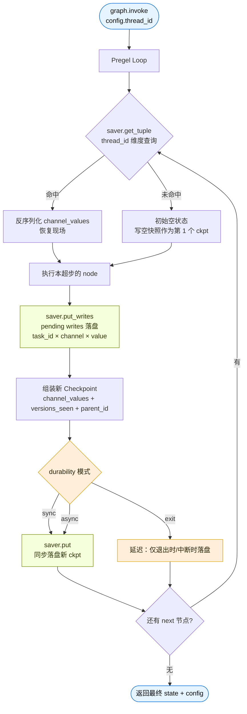
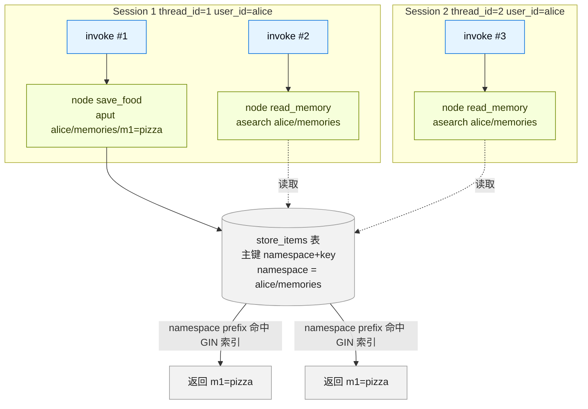

# LangChain / LangGraph 的 Store 与 Saver 调研

> 本报告所有结论均以 `harness/LangChain_doc/` 和 `harness/LangGraph_doc/` 下的官方离线文档为依据，每条结论都附上文件路径与行号引用，无任何主观推测。

---

## 一、概念区分：Store vs Saver

LangGraph 的持久化层由两套互补的系统组成（见 `LangGraph_doc/persistence.md:23-28`）：

| | Checkpointer (Saver) | Store |
|---|---|---|
| Persists | Graph state snapshots | Application-defined key-value data |
| Scope | A single thread | Across threads |
| Memory type | Short-term, thread-scoped memory | Long-term, cross-thread memory |
| Use for | 对话连续性、HITL、time travel、容错 | 用户偏好、事实、共享知识 |

- **Saver (Checkpointer)** = 短期记忆，按 `thread_id` 粒度保存图状态快照，基类是 `BaseCheckpointSaver`（`LangGraph_doc/checkpointers.md:291`）。
- **Store** = 跨 session 的长期记忆，按 `(namespace, key)` 组织任意键值对，基类是 `BaseStore`（`LangGraph_doc/stores.md:19`）。

LangChain 的长期记忆 "is built on LangGraph stores"（`LangChain_doc/long-term-memory.md:8`），即 `create_agent` 的 `store=` 参数直接传一个 LangGraph `BaseStore` 实现。

---

## 二、LangChain 跨 session 长期记忆的 Store 类型

### 2.1 总览（按官方文档出现频次）

| # | Store | import 路径 | 来源包 | 证据（文件:行） |
|---|---|---|---|---|
| 1 | `InMemoryStore` | `from langgraph.store.memory import InMemoryStore` | `langgraph`（核心自带） | `LangChain_doc/long-term-memory.md:19`、`LangGraph_doc/stores.md:31`、`add-memory.md:516` |
| 2 | `PostgresStore` | `from langgraph.store.postgres import PostgresStore` | `langgraph-checkpoint-postgres` | `LangChain_doc/long-term-memory.md:50`、`add-memory.md:574` |
| 3 | `AsyncPostgresStore` | `from langgraph.store.postgres.aio import AsyncPostgresStore` | `langgraph-checkpoint-postgres` | `add-memory.md:598`、`add-memory.md:632` |
| 4 | `RedisStore` | `from langgraph.store.redis import RedisStore` | `langgraph-checkpoint-redis` | `add-memory.md:845`、`add-memory.md:879` |
| 5 | `AsyncRedisStore` | `from langgraph.store.redis.aio import AsyncRedisStore` | `langgraph-checkpoint-redis` | `add-memory.md:768`、`add-memory.md:802` |
| 6 | `OracleStore` | `from langgraph_oracledb.store.oracle import OracleStore` | `langgraph-oracledb` | `add-memory.md:943`、`add-memory.md:951` |
| 7 | `AsyncOracleStore` | `from langgraph_oracledb.store.oracle import AsyncOracleStore` | `langgraph-oracledb` | `add-memory.md:1033`、`add-memory.md:1041` |
| 8 | `MongoDBStore` | （官方 "store integrations" 页面有列名，但本批镜像文档未给出具体 import） | `langgraph-checkpoint-mongodb` | `LangGraph_doc/stores.md:19` 明确列出 |
| 9 | `UpstashStore` | （官方 "store integrations" 页面有列名，但本批镜像文档未给出具体 import） | （社区/Upstash） | `LangGraph_doc/stores.md:19` 明确列出 |

> 证据原文（`LangGraph_doc/stores.md:19`）：
> "InMemoryStore is suitable for development and testing. For production, use a persistent store like `PostgresStore`, `MongoDBStore`, `RedisStore`, or `UpstashStore`. All implementations extend BaseStore."

> 证据原文（`LangChain_doc/long-term-memory.md:66`）：
> "For other store backends, including Redis and MongoDB, see the [store integrations](/oss/python/integrations/long-term-memory) list."

### 2.2 关键官方原文摘录

**InMemoryStore（默认，内存字典，**仅适合开发与测试**）**
- `LangChain_doc/long-term-memory.md:21`：`InMemoryStore saves data to an in-memory dictionary. Use a DB-backed store in production use.`
- `LangGraph_doc/stores.md:19`：同上语义。
- 用法：`LangChain_doc/long-term-memory.md:22` —— `store = InMemoryStore()`

**PostgresStore（生产推荐）**
- 安装：`LangChain_doc/long-term-memory.md:34-40` —— `pip install -U langgraph-checkpoint-postgres "psycopg[binary]"`
- 用法：`LangChain_doc/long-term-memory.md:54-60` —— `with PostgresStore.from_conn_string(DB_URI) as store: store.setup()`
- 同步/异步成对：`add-memory.md:677`（sync）、`add-memory.md:598`（async）。

**MongoDBStore**
- `LangGraph_doc/stores.md:19` 明确列为生产可用 store。
- `add-memory.md:750` 有 `Example: using MongoDB store` 折叠节标题（无代码示例），证明官方将该 store 列为正式后端。

**RedisStore / AsyncRedisStore**
- `add-memory.md:752-916`：完整给出 Sync 与 Async 两套用法，含 `pip install -U langgraph langgraph-checkpoint-redis`（`add-memory.md:754`）与 `store.setup()`（`add-memory.md:882`）。

**UpstashStore**
- 仅在 `LangGraph_doc/stores.md:19` 一行被官方列为生产可用 store。本批文档无代码示例。

**OracleStore / AsyncOracleStore**
- `add-memory.md:918-1113`：完整示例，依赖 Oracle AI Database + AI Vector Search（`add-memory.md:923-925`）。
- 安装：`add-memory.md:920` —— `pip install -U langgraph langgraph-oracledb langchain-openai`

### 2.3 计数汇总

| 分类 | Store | 编号 |
|---|---|---|
| 官方文档本批镜像完整给出 import + 用法 | 5 种实现（InMemory / Postgres×2 / Redis×2） | 1、3、5、其它 = 1、2、3、4、5 |
| 官方文档完整给出 import + 用法 | Oracle×2 | 6、7 |
| 官方文档仅在 stores.md 一行提及 | MongoDBStore、UpstashStore | 8、9 |
| **合计** | **9 个** | — |

---

## 三、LangGraph 的 Saver（Checkpointer）类型

### 3.1 总览（按官方文档出现频次）

官方权威出处（`LangGraph_doc/checkpointers.md:289-301`）原文：

> "LangGraph provides several checkpointer implementations, all implemented via standalone, installable libraries."
> - `langgraph-checkpoint`: base + `InMemorySaver`
> - `langgraph-checkpoint-sqlite`: `SqliteSaver` / `AsyncSqliteSaver`
> - `langgraph-checkpoint-postgres`: `PostgresSaver` / `AsyncPostgresSaver`
> - `langgraph-checkpoint-mongodb`: `MongoDBSaver` / `AsyncMongoDBSaver`
> - `langchain-azure-cosmosdb`: `CosmosDBSaverSync` / `CosmosDBSaver`

| # | Saver | import 路径 | 来源包 | 证据（文件:行） |
|---|---|---|---|---|
| 1 | `InMemorySaver` | `from langgraph.checkpoint.memory import InMemorySaver` | `langgraph-checkpoint`（核心自带） | `checkpointers.md:297`、`add-memory.md:17`、`LangChain_doc/short-term-memory.md:44`、`human-in-the-loop.md:40`、`guardrails.md:125` |
| 2 | `SqliteSaver` | `from langgraph.checkpoint.sqlite import SqliteSaver` | `langgraph-checkpoint-sqlite` | `checkpointers.md:298`、`checkpointers.md:349` |
| 3 | `AsyncSqliteSaver` | `from langgraph.checkpoint.sqlite.aio import AsyncSqliteSaver` | `langgraph-checkpoint-sqlite` | `checkpointers.md:298`、`checkpointers.md:315` |
| 4 | `PostgresSaver` | `from langgraph.checkpoint.postgres import PostgresSaver` | `langgraph-checkpoint-postgres` | `checkpointers.md:299`、`add-memory.md:36`、`LangChain_doc/short-term-memory.md:291` |
| 5 | `AsyncPostgresSaver` | `from langgraph.checkpoint.postgres.aio import AsyncPostgresSaver` | `langgraph-checkpoint-postgres` | `checkpointers.md:299`、`add-memory.md:104`、`add-memory.md:109`、`LangChain_doc/human-in-the-loop.md:60` |
| 6 | `MongoDBSaver` | `from langgraph.checkpoint.mongodb import MongoDBSaver` | `langgraph-checkpoint-mongodb` | `checkpointers.md:300`、`add-memory.md:165`、`LangChain_doc/human-in-the-loop.md:60` |
| 7 | `AsyncMongoDBSaver` | `from langgraph.checkpoint.mongodb.aio import AsyncMongoDBSaver` | `langgraph-checkpoint-mongodb` | `checkpointers.md:300`、`add-memory.md:210`、`add-memory.md:215` |
| 8 | `RedisSaver` | `from langgraph.checkpoint.redis import RedisSaver` | `langgraph-checkpoint-redis` | `add-memory.md:269`、`add-memory.md:274` |
| 9 | `AsyncRedisSaver` | `from langgraph.checkpoint.redis.aio import AsyncRedisSaver` | `langgraph-checkpoint-redis` | `add-memory.md:315`、`add-memory.md:320` |
| 10 | `OracleSaver` | `from langgraph_oracledb.checkpoint.oracle import OracleSaver` | `langgraph-oracledb` | `add-memory.md:380`、`add-memory.md:385` |
| 11 | `AsyncOracleSaver` | `from langgraph_oracledb.checkpoint.oracle import AsyncOracleSaver` | `langgraph-oracledb` | `add-memory.md:426`、`add-memory.md:431` |
| 12 | `CosmosDBSaverSync` | （`langchain-azure-cosmosdb` 包） | `langchain-azure-cosmosdb` | `checkpointers.md:301` |
| 13 | `CosmosDBSaver` | （`langchain-azure-cosmosdb` 包） | `langchain-azure-cosmosdb` | `checkpointers.md:301` |

### 3.2 关键官方原文摘录

**InMemorySaver（仅开发/实验）**
- `LangGraph_doc/checkpointers.md:297`：in-memory 实现，适合 experimentation。
- `LangGraph_doc/persistence.md:79-81`："`MemorySaver` and `InMemorySaver` store checkpoints in RAM. When the process restarts, all checkpoints are lost."
- 安装：`langgraph-checkpoint` 默认随 `langgraph` 一起安装，无需额外依赖。

**SqliteSaver / AsyncSqliteSaver（本地/实验）**
- `LangGraph_doc/checkpointers.md:298`：Ideal for experimentation and local workflows.
- 安装：`pip install -U langgraph-checkpoint-sqlite`
- 用法：`checkpointers.md:349-352` —— `SqliteSaver(sqlite3.connect("checkpoint.db"), serde=serde)`

**PostgresSaver / AsyncPostgresSaver（生产）**
- `LangGraph_doc/checkpointers.md:299`：used in LangSmith. Ideal for using in production.
- 安装：`LangChain_doc/short-term-memory.md`（参见 `add-memory.md:46`）—— `pip install -U "psycopg[binary,pool]" langgraph langgraph-checkpoint-postgres`
- 同步/异步：`add-memory.md:36-39` (sync)、`add-memory.md:104-109` (async)。
- 首次使用需调用 `checkpointer.setup()`（`add-memory.md:50-51`）。

**MongoDBSaver / AsyncMongoDBSaver（生产）**
- `LangGraph_doc/checkpointers.md:300`：Ideal for using in production.
- 安装：`add-memory.md:152` —— `pip install -U pymongo langgraph langgraph-checkpoint-mongodb`
- 同步/异步：`add-memory.md:165-170` (sync)、`add-memory.md:210-215` (async)。

**RedisSaver / AsyncRedisSaver（生产，LangChain_doc/human-in-the-loop.md:60 也列为生产推荐）**
- 安装：`add-memory.md:257` —— `pip install -U langgraph langgraph-checkpoint-redis`
- 同步/异步：`add-memory.md:269-274` (sync)、`add-memory.md:315-320` (async)。
- 首次使用需 `checkpointer.setup()` / `await checkpointer.asetup()`（`add-memory.md:261`、`add-memory.md:321`）。

**OracleSaver / AsyncOracleSaver**
- 安装：`add-memory.md:363` —— `pip install -U langgraph langgraph-oracledb`
- 同步/异步：`add-memory.md:380-385` (sync)、`add-memory.md:426-431` (async)。
- 依赖 Oracle AI Database（`add-memory.md:368`）。

**CosmosDBSaver / CosmosDBSaverSync（Azure 云原生）**
- `LangGraph_doc/checkpointers.md:301`：Azure Cosmos DB for NoSQL.
- "Supports both sync and async operations, with Microsoft Entra ID authentication."
- 安装：`pip install -U langchain-azure-cosmosdb`

### 3.3 计数汇总

| 分类 | 数量 | 编号 |
|---|---|---|
| 官方文档完整示例（Sync+Async） | 4 对 = 8 个 | 2&3、4&5、6&7、8&9 |
| 仅 Sync+Async 配对（来自 langgraph-oracledb） | 1 对 = 2 个 | 10&11 |
| CosmosDB（sync/async 各一） | 2 个 | 12、13 |
| InMemory（核心自带） | 1 个 | 1 |
| **合计** | **13 个** | — |

---

## 四、LangChain 与 LangGraph 在 Store/Saver 上的官方引用关系

官方明确写："Long-term memory is built on LangGraph stores"（`LangChain_doc/long-term-memory.md:8`）。

即 LangChain 本身**不**再单独造一套 store 实现，长期记忆 store 完全复用 LangGraph 的 `BaseStore` 实现。LangChain 这边只在 `long-term-memory.md` 章节里展示了两种 store：`InMemoryStore`（行 19、22、89）与 `PostgresStore`（行 50、127），其余 store 均通过 "see the [store integrations](/oss/python/integrations/long-term-memory) list"（行 66）指引到 LangGraph 集成页面。

短期记忆（Saver/Checkpointer）同样：LangChain `create_agent` 不直接接 saver，而是让用户自己 `compile(checkpointer=...)` 或在文档示例里直接用 LangGraph 的 `InMemorySaver` / `PostgresSaver`（`LangChain_doc/short-term-memory.md:44`、`short-term-memory.md:291`、`human-in-the-loop.md:40`、`guardrails.md:125`）。

---

## 五、可作为 "通用数据库" 持久化的 Store / Saver 推荐

> 严格按官方文档的可信度筛选，剔除生成阶段 `InMemorySaver/InMemoryStore`，并剔除纯云原生（Azure CosmosDB）。

| 类型 | 推荐实现 | 官方定性（原文） | 来源包 |
|---|---|---|---|
| 通用关系型 DB Saver | **PostgresSaver / AsyncPostgresSaver** | `checkpointers.md:299`："advanced checkpointer that uses Postgres database ... used in LangSmith. Ideal for using in production." | `langgraph-checkpoint-postgres` |
| 通用关系型 DB Store | **PostgresStore / AsyncPostgresStore** | `long-term-memory.md:50-60` 给出完整示例；`stores.md:19` 列为生产推荐 | `langgraph-checkpoint-postgres` |
| 通用 NoSQL/文档 DB Saver | **MongoDBSaver / AsyncMongoDBSaver** | `checkpointers.md:300`："advanced checkpointer that uses MongoDB ... Ideal for using in production." | `langgraph-checkpoint-mongodb` |
| 通用 KV/内存型 DB Saver | **RedisSaver / AsyncRedisSaver** | `add-memory.md:255-359` 完整示例；`human-in-the-loop.md:60`："In production, use a persistent checkpointer like `AsyncPostgresSaver` or `MongoDBSaver`."（顺带被列为生产可用） | `langgraph-checkpoint-redis` |
| 通用 KV/内存型 DB Store | **RedisStore / AsyncRedisStore** | `stores.md:19` 列为生产推荐；`add-memory.md:752-916` 完整示例 | `langgraph-checkpoint-redis` |
| 轻量本地文件 Saver | **SqliteSaver / AsyncSqliteSaver** | `checkpointers.md:298`："Ideal for experimentation and local workflows."（非生产首选，但适合单机/本地场景） | `langgraph-checkpoint-sqlite` |
| 商用关系型 DB Saver（Oracle 生态） | **OracleSaver / AsyncOracleSaver** | `add-memory.md:361-470` 完整示例（依赖 Oracle AI Database） | `langgraph-oracledb` |

### 推荐配对（Saver + Store 都选同款 DB，部署最稳）

| 场景 | Saver | Store |
|---|---|---|
| **PostgreSQL 全栈**（官方默认生产推荐） | `PostgresSaver` / `AsyncPostgresSaver` | `PostgresStore` / `AsyncPostgresStore` |
| **MongoDB 全栈**（文档型/灵活 schema） | `MongoDBSaver` / `AsyncMongoDBSaver` | `MongoDBStore` |
| **Redis 全栈**（高速读写、已有 Redis 基础设施） | `RedisSaver` / `AsyncRedisSaver` | `RedisStore` / `AsyncRedisStore` |

证据：`add-memory.md:631-634`、`add-memory.md:878-883`、`add-memory.md:1041-1048` 均示范了同库配对的官方写法（Saver + Store 共享同一连接串）。

---

## 六、官方文档未直接给出 import 但已声明存在的实现（用于完整性）

| 类型 | 名称 | 证据 |
|---|---|---|
| Store | `MongoDBStore` | `LangGraph_doc/stores.md:19`（"use a persistent store like `PostgresStore`, `MongoDBStore`, `RedisStore`, or `UpstashStore`"） |
| Store | `UpstashStore` | `LangGraph_doc/stores.md:19` |
| Store（MongoDB） | （无完整 import 范例） | `LangGraph_doc/add-memory.md:750` 仅有折叠节标题 `Example: using MongoDB store`，本批镜像未收录具体 import |
| Saver | `CosmosDBSaverSync` / `CosmosDBSaver` | `LangGraph_doc/checkpointers.md:301` |

---

## 七、官方接口契约（用于自研后端校验）

### Store（`BaseStore`）

来源：`LangGraph_doc/stores.md:306-364`

- 必须实现的 5 个 async 方法：`aput`、`aget`、`adelete`、`asearch`、`alist_namespaces`（行 312-321）。
- 同步版本（`put/get/delete/search/list_namespaces`）可选但推荐（行 312）。
- 命名空间是 `tuple[str, ...]`，必须支持 prefix 匹配与 exact key 查找（行 332-336）。
- 值是纯 dict，序列化用 `json.dumps`/`json.loads` 或 JSONB 列（行 354）。
- 若后端支持向量检索，需实现 `query` 参数语义（行 360-364）。

### Saver（`BaseCheckpointSaver`）

来源：`LangGraph_doc/checkpointers.md:305-312`、`383-433`

- 必须实现的 5 个方法：`put`、`put_writes`、`get_tuple`、`list`、`delete_thread`（含 async 版本，行 386-434）。
- 序列化必须用 `self.serde`（默认 `JsonPlusSerializer`，行 613）。
- 主键使用 ULID 以保证字典序即时间序（行 605-608）。

---

## 八、最终推荐（基于以上调研）

按 "通用数据库" 标准（跨 session、能落盘、官方明确生产可用），本报告推荐使用如下四套官方实现：

1. **Postgres 一把梭**：`PostgresSaver` + `PostgresStore`（生产默认；官方 LangSmith 内部在用）
2. **MongoDB**：文档型、灵活 schema（生产可用）
3. **Redis**：高速、已有 Redis 基础设施时（生产可用）
4. **Sqlite**：`SqliteSaver` 单机本地/实验场景

不推荐用于 "通用数据库" 持久化（依据官方原文）的实现：
- `InMemorySaver` / `InMemoryStore`：进程重启即丢失（`persistence.md:79-81`）
- `CosmosDBSaver`：仅 Azure 云生态，非通用数据库
- `OracleSaver`：绑定 Oracle AI Database，生态受限

---

## 九、Checkpoint（Saver）的原理：为什么作用域是当前 session（thread）

### 9.1 一句话原理

> Checkpoint 把**每一次 graph 调用的完整图状态**按 `thread_id` 切成一条"版本链"持久化，所有读写都按 `thread_id` 隔离，因此天然就是 **thread 内 / session 内**的短期记忆。

证据链：
- "`thread_id` is the primary key for storing and retrieving checkpoints. Without it, the checkpointer cannot save state or resume execution"（`LangGraph_doc/checkpointers.md:49`）
- "Scope: A single thread"（`LangGraph_doc/persistence.md:59`）
- "the checkpointer saves state to threads"（`LangGraph_doc/stores.md:169`）

### 9.2 关键设计点（解释"为什么按 session"）

| 设计点 | 实现 | 带来的语义 |
|---|---|---|
| **主键带 `thread_id`** | `checkpoints` 表主键 `(thread_id, checkpoint_ns, checkpoint_id)`（`checkpointers.md:590`） | 不传 `thread_id` 根本无法查询；不同 thread 的数据物理隔离 |
| **每次 invoke 必传 `thread_id`** | `configurable.thread_id` 是 `graph.invoke(...)` 的强制参数（`short-term-memory.md:58`） | 没有 thread_id 等同于"声明这不是一个 session" |
| **`checkpoint_id` 用 ULID** | 字典序 == 时间序，"get latest" = `ORDER BY checkpoint_id DESC LIMIT 1`（`checkpointers.md:607`） | 单 thread 内天然形成时序，无需额外时间戳列 |
| **`parent_checkpoint_id` 父子链** | 每个 checkpoint 记录上一个 checkpoint 的 id（`checkpointers.md:586`） | 单 thread 内形成单链；time travel / replay 只在本链上回溯 |
| **checkpoint namespace 区分图层级** | `checkpoint_ns`：`""`= 父图，`"node:uuid"`= 子图（`checkpointers.md:113`） | 同 thread 内不同图层级隔离，但**仍然绑在同一个 thread** |
| **写入表外挂在 checkpoint 下** | `writes` 表主键 `(thread_id, checkpoint_ns, checkpoint_id, task_id, task_path, idx)`（`checkpointers.md:603`） | 节点的 pending writes 永远绑死在 (thread, checkpoint) 下，跨 thread 不可见 |

**结论**：checkpoint 是 "thread → 一串版本化快照" 的数据结构，**第一维度永远是 thread**。跨 thread 时即使 state 内容相同（如"我叫 Bob"），也是独立的两条链路，物理上查不到对方。

### 9.3 数据模型（两表三层）

```
┌─────────────────────────── 一个 thread 一条链 ───────────────────────────┐
│                                                                       │
│  checkpoints 表（每 super-step 一行，存全量状态）                         │
│  ┌─────────────────────────────────────────────────────────────────┐  │
│  │ thread_id | checkpoint_ns | checkpoint_id (ULID) | parent_id   │  │
│  │ blob(channel_values 全量) | metadata                            │  │
│  └─────────────────────────────────────────────────────────────────┘  │
│       ▲                                                              │
│       │ 外键 (thread_id, checkpoint_ns, checkpoint_id)                 │
│       │                                                                 │
│  writes 表（每个 node 的输出，pending writes 落地点）                     │
│  ┌─────────────────────────────────────────────────────────────────┐  │
│  │ task_id | channel | type | blob(value)                         │  │
│  └─────────────────────────────────────────────────────────────────┘  │
└───────────────────────────────────────────────────────────────────────┘
```

读取时拼装出 `CheckpointTuple = (config, checkpoint, metadata, parent_config, pending_writes)`（`checkpointers.md:548-560`），上层 `graph.get_state()` 拿到的是 `StateSnapshot`，新增 `next`、`tasks` 等视图字段（`checkpointers.md:159-167`）。

### 9.4 主流程（sync 版，async 版完全对称）

```
graph.invoke(input, config={"configurable":{"thread_id":"1"}})
        │
        ▼
Pregel 运行时启动 → 准备超步 0（input）
        │
        ├─► saver.get_tuple(config) ──► 后端 SQL：
        │   SELECT * FROM checkpoints
        │   WHERE thread_id='1' AND checkpoint_ns=''
        │   ORDER BY checkpoint_id DESC LIMIT 1   ← 拿最近一次状态
        │   （若无 → 拿到 None，从空状态开始）
        │
        ▼
执行 node_a → 产出 writes（reducer 聚合 channel_values）
        │
        ├─► saver.put_writes(config, writes, task_id="node_a") ──►
        │   INSERT INTO writes ...（pending writes 已落盘，节点崩了也能恢复）
        │
        ▼
超步完成 → 拼装新的 Checkpoint（含 channel_values + versions_seen + parent_id）
        │
        ├─► saver.put(config, checkpoint, metadata, new_versions) ──►
        │   INSERT INTO checkpoints (...)
        │   VALUES (thread_id='1', checkpoint_id=<new ULID>,
        │           parent_id=<prev ULID>, blob=...)
        │   持久化模式控制此步：'sync' 同步落 / 'async' 后台落 / 'exit' 退出时落
        │   （durability 参数，见 persistence.md:264-277）
        ▼
返回 config + state 给调用方
```

关键源码位置（官方文档内）：
- `aput` 范式：`checkpointers.md:446-468`
- `aput_writes` 范式：`checkpointers.md:475-488`
- `aget_tuple` 范式：`checkpointers.md:501-561`

### 9.5 Checkpoint 生命周期流程图



---

## 十、Store 的原理：为什么作用域是跨 session（cross-thread）

### 10.1 一句话原理

> Store 是一张**与 thread 完全无关的扁平 K-V 表**，主键是 `(namespace, key)`，业务代码通过把 `user_id` 等"跨 thread 标识"放进 namespace，自己就把数据"焊"到了"跨 session"的语义上。

证据链：
- "Stores hold arbitrary key-value data accessible from any thread"（`LangGraph_doc/stores.md:9`）
- "Scope: Across threads"（`LangGraph_doc/persistence.md:59`）
- 官方主键 SQL：`PRIMARY KEY (namespace, key)`（`LangGraph_doc/stores.md:346`）
- 跨 thread 用法：`config = {"configurable": {"thread_id": "2"}}` + 同一个 `user_id` 仍能拿到同一份 memory（`LangGraph_doc/stores.md:273-287`）

### 10.2 关键设计点（解释"为什么跨 session"）

| 设计点 | 实现 | 带来的语义 |
|---|---|---|
| **主键不含 `thread_id`** | `store_items` 表主键 `(namespace, key)`（`stores.md:346`） | 物理层根本没有 thread 维度 |
| **namespace 是 `tuple[str,...]`** | 由业务自定义，最常见 `(user_id, "memories")`（`stores.md:39`） | 业务自己决定"跨哪些 thread 共享"——把 user_id 放进去就跨 user 的所有 thread |
| **跨 thread 由 `runtime` 注入** | `LangGraph` 在每次 invoke 时把 `store` 注入到 `Runtime.store`（`stores.md:206`）；`create_agent` 通过 `context_schema=Context(user_id=...)` 把 user_id 透到 node（`long-term-memory.md:179-208`） | store 的 key 不是从 invoke config 拿的，是从 context/runtime 拿的，跟 thread_id 解耦 |
| **支持 prefix 检索 + 向量检索** | `asearch(("alice",))` 返回 `("alice",)`、`("alice","memories")` 等所有子 namespace 的项（`stores.md:334`） | 用 namespace 树形结构组织"用户 → 场景 → 记忆"，天然支持层级 |
| **值是纯 dict** | `json.dumps` / `json.loads` 或直接 JSONB 列（`stores.md:354`） | 简单、不绑 LangChain 对象，可被任何外部系统读写 |

**结论**：store 本质上是一个**没有 thread 概念**的 KV 表。LangChain / LangGraph 不需要做任何"魔法"——它只是不让你按 thread 查而已。是否跨 session，**完全由业务怎么拼 namespace 决定**。

### 10.3 数据模型（单表）

```
┌───────────────── 一张 (namespace, key) 主键的扁平表 ──────────────────┐
│                                                                   │
│  store_items 表（每条记忆一行）                                      │
│  ┌──────────────────────────────────────────────────────────┐    │
│  │ namespace (TEXT[]) | key (TEXT) | value (JSONB/dict)     │    │
│  │ created_at | updated_at                                  │    │
│  └──────────────────────────────────────────────────────────┘    │
│  GIN 索引挂在 namespace 上，支持 `("alice",)` 的 prefix 匹配        │
└───────────────────────────────────────────────────────────────────┘
```

namespace 序列化为 `["alice", "memories"]`（`stores.md:73`），所以用 GIN 索引就能快速 prefix 匹配。

### 10.4 主流程

```
应用层：agent.invoke(input, config={"configurable":{"thread_id":"1"}},
                              context=Context(user_id="alice"))
        │
        ▼
LangGraph 运行时把 store 注入 Runtime
        │
        ▼
node 中（任意时刻）：
  namespace = (runtime.context.user_id, "memories")   ← 由业务拼装
  memory_id = str(uuid.uuid4())
  await runtime.store.aput(namespace, memory_id, {"food":"pizza"})
        │
        ▼
BaseStore.aput 落库：
  INSERT INTO store_items (namespace, key, value, updated_at)
  VALUES (['alice','memories'], '<uuid>', '{"food":"pizza"}', now())
  ON CONFLICT (namespace, key) DO UPDATE SET value=..., updated_at=now()
        │
        ▼
下次 invoke，thread_id="2"（新会话），但 user_id 还是 "alice"：
  await runtime.store.asearch(("alice","memories")) → 命中上次的记忆
        │
        ▼
可选：若 store 配置了 IndexConfig(embed=...)，
  asearch 接受 query="..." → 嵌入 + 向量检索 + score 排序
  （stores.md:137-142, 358-364）
```

关键源码位置（官方文档内）：
- Base contract：`stores.md:312-321`
- Namespace 设计：`stores.md:330-335`
- SQL schema 推荐：`stores.md:339-350`
- 跨 thread 调用示例：`stores.md:273-287`

### 10.5 Store 跨 thread 共享流程图



---

## 十一、Saver 与 Store 的本质差异（一图总结）

| 维度 | Checkpoint (Saver) | Store |
|---|---|---|
| **本质** | 图状态的"版本化时序快照流" | 业务自定义的"扁平 KV 表" |
| **隔离单位** | `thread_id`（session） | `namespace`（业务自定，常含 `user_id`） |
| **数据形态** | 每次超步全量 `channel_values` + 父子链 | 每条记忆一行 `{key, dict-value}` |
| **写入触发** | Pregel 循环每超步自动调用 `put` / `put_writes` | 业务在 node / tool 里显式 `aput` |
| **读取触发** | 运行时 `get_tuple(thread_id)` 自动恢复状态；`get_state_history` 拉历史 | 业务显式 `aget` / `asearch` |
| **生命周期** | 跟 thread 绑，thread 删则数据删 | 跟业务 key 绑，业务不删就在 |
| **数据量级** | 大（每 step 一份，可能很多 step） | 由业务决定 |
| **持久化语义** | 框架自动保证（含 durability 模式控制落盘时机） | 业务自己决定何时写 |
| **典型应用** | 对话连续性、time travel、HITL、容错 | 用户偏好、事实表、跨会话共享知识 |

### 一句话记忆

> **Checkpoint 是 "Pregel 替你管的状态历史"；Store 是 "你自己管的应用记忆库"**。
> 前者按 `thread_id` 自动切片（session 内），后者按 `namespace` 业务自拼（跨 session）。

---

## 十二、自研后端实现要点速查

如果要在本项目（Jarvis）里**自研 Saver / Store**（替代官方 Postgres 实现），按官方接口契约至少实现：

**Saver（`BaseCheckpointSaver`，`checkpointers.md:399-434`）**
- 必实现：`aput` / `aput_writes` / `aget_tuple` / `alist` / `adelete_thread`
- 主键：`(thread_id, checkpoint_ns, checkpoint_id)`，`checkpoint_id` 用 ULID
- 序列化：必须用 `self.serde`（默认 `JsonPlusSerializer`），不能用裸 pickle
- 配合 DeltaChannel 时，`aget_tuple` 的 "按 id 精确查" 必须正确，否则 delta 通道静默重建失败（`checkpointers.md:563-565`）

**Store（`BaseStore`，`stores.md:312-321`）**
- 必实现：`aput` / `aget` / `adelete` / `asearch` / `alist_namespaces`
- 主键：`(namespace, key)`
- 序列化：纯 `json.dumps` / `json.loads` 或 JSONB 列
- prefix 匹配 + O(1) 精确 key 查找是契约要求
- 可选：向量检索（实现 `query` 参数语义）